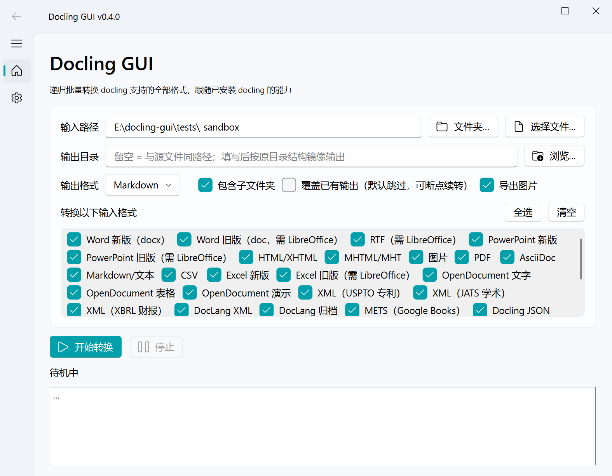
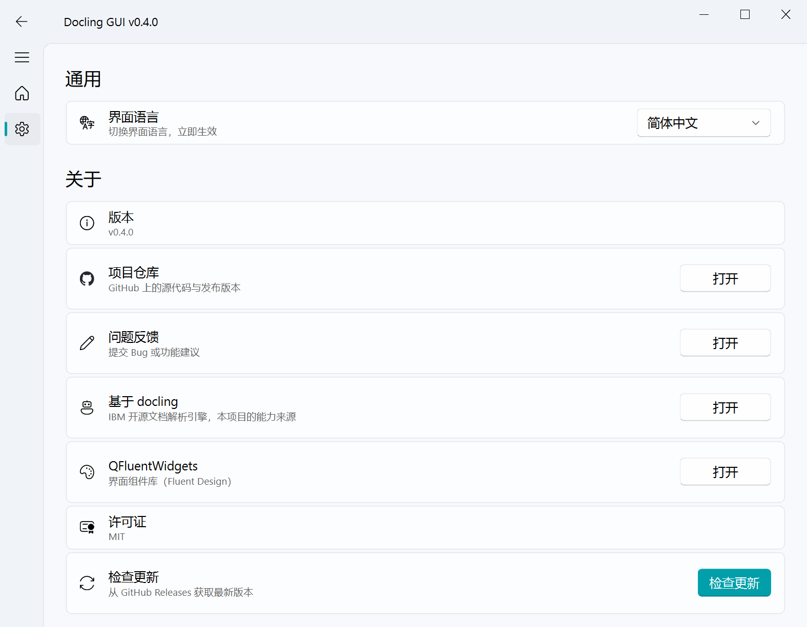

# Docling GUI

[](https://github.com/Ikaros-521/docling-gui/actions/workflows/build.yml)
[](https://github.com/Ikaros-521/docling-gui/releases)
[](LICENSE)
[](pyproject.toml)

English | [简体中文](README.md)

**Docling GUI is a free, open-source (MIT) desktop app for batch document conversion.**
It is a ready-to-use graphical interface for [docling](https://github.com/docling-project/docling)
(IBM's open-source document parsing engine): recursively convert **PDF, Word, Excel,
PowerPoint, images, audio — all 37 format families / 88 extensions docling supports —
into Markdown / HTML / JSON / DocTags / plain text**. Windows / macOS / Linux.
**100% local and offline, no code required — your documents never leave your machine.**

> In one line: the GUI for docling. Batch-convert PDF to Markdown without writing Python.



## 🎯 Use cases

- **Knowledge base / note migration**: batch-convert PDF, Word and web pages to Markdown for Obsidian, Logseq, Notion, etc.
- **RAG / LLM data preparation**: Markdown, lossless JSON (DoclingDocument) or DocTags output for chunking and retrieval
- **Office archiving**: recursively process years of legacy .doc / .xls / .ppt (with LibreOffice) into one uniform output
- **Scanned-document OCR**: images and scanned PDFs to searchable text (docling's built-in OCR)
- **Audio/video transcription**: audio files and video sound tracks to text (ASR)

## ✨ Features

- 📂 **Recursive batch / single file**: point it at a folder (all subfolders) or one file
- 🎯 **Selectable output directory**: empty = same path as sources; set = mirror the original tree (images stored beside outputs)
- ✅ **Input format checkboxes**: 37 input formats (incl. legacy Office, audio, email — full docling capability), discovered dynamically from the installed docling
- 🌐 **Chinese / English UI**: one click in Settings, applied instantly; first launch follows the system locale
- 🔄 **Update check**: query the latest GitHub release from the Settings page
- 📤 **Five output formats**: Markdown / HTML / JSON (lossless DoclingDocument) / DocTags XML / plain text
- 🖼️ **Image export**: embedded images go to `<name>_images/` with relative links (md/html/json)
- ⏸️ **Interruptible**: runs in a background thread; existing outputs are skipped by default (resume-friendly)
- 💻 **GUI + CLI**; unit tests for the core logic (`pytest tests/`)



## 📥 Supported input formats (official docling list)

| Format | Notes / dependencies |
|---|---|
| PDF | Models (layout/table/OCR) downloaded automatically on first use |
| DOCX / XLSX / PPTX (Office 2007+) | Pure parsing, no models |
| DOC / XLS / PPT, RTF (legacy binary) | Requires [LibreOffice](https://www.libreoffice.org/) |
| ODT / ODS / ODP (OpenDocument) | None |
| EPUB | None |
| HTML / XHTML / MHTML | None |
| Markdown / AsciiDoc / LaTeX / CSV / plain text | None |
| PNG / JPEG / TIFF / BMP / WEBP / GIF | OCR models downloaded on first use |
| WAV / MP3 / M4A / AAC / OGG / FLAC (audio) | ASR models downloaded on first use |
| MP4 / AVI / MOV / MKV / WEBM (video, audio track only) | Same, plus system ffmpeg |
| Email (.eml / .msg), iCalendar, WebVTT, BoxNote, USPTO/JATS/XBRL XML, DocLang XML/archive, etc. | None |
| Pages / Numbers / Keynote | iWork plugin required (not enabled by default) |

Exact list on your machine: `docling-gui --list-formats` (the GUI checkbox panel is generated from the same source).

## 📤 Output formats

| Format | Suffix | Notes |
|---|---|---|
| Markdown | `.md` | relative image links |
| HTML | `.html` | relative image links |
| JSON | `.json` | lossless DoclingDocument (images referenced) |
| DocTags | `.doctags` | XML doc tags (training / RAG chunking) |
| Plain text | `.txt` | text only |

## 📥 Download

Grab the archive for your platform from [Releases](../../releases):

| File | Platform |
|---|---|
| `docling-gui-windows-x64.zip` | Windows 10+ x64 |
| `docling-gui-macos-arm64.zip` | macOS 12+ Apple Silicon |
| `docling-gui-linux-x64.zip` | Linux x64 |

> **Size note**: the all-formats build bundles the torch/transformers/OCR stack — archives are in the GB range.
> **macOS "damaged" warning**: right-click → Open, or `xattr -cr /path/to/docling-gui.app`.
> **Linux**: needs xcb/xkbcommon runtime libs (`sudo apt install libxcb-cursor0 libxkbcommon0 libegl1` if missing).
> The packaged app has no console; use a source checkout for heavy CLI work.

## 🖱️ Usage

### GUI

1. Input path: pick a folder (recursive) or a single file; drag & drop works too
2. Output directory: empty = same path as sources; set = mirror the original tree
3. Output format + input-format checkboxes + subfolder / overwrite / images options
4. Click **Start** — the log shows per-file results in real time

### CLI

```bash
docling-gui D:\docs                       # folder, Markdown output
docling-gui D:\docs\report.docx           # single file
docling-gui D:\docs --out E:\md_out       # mirrored output directory
docling-gui D:\docs --formats pdf,docx,image

--to md|html|json|doctags|txt   output format (default md)
--out DIR                       output directory
--formats NAME[,NAME...]        restrict input formats
--overwrite / --no-images / --flat
--list-formats                  list supported formats
--version
```

## ❓ FAQ

**Q: What is Docling GUI? How does it relate to docling?**
A: docling is IBM's open-source document parsing engine (Python library / CLI). Docling GUI
is its desktop GUI and batch-conversion wrapper: identical parsing quality, plus recursive
batch jobs, per-format selection, image export, pause/resume, a Chinese/English UI and
prebuilt packages for three platforms.

**Q: Do I need Python or any coding?**
A: No. Download a package from Releases, unzip and run. Only a source checkout needs Python 3.10+.

**Q: Are my documents uploaded to the cloud?**
A: No. All parsing runs locally. docling models are downloaded once on first use (cached in
`~/.cache/docling`); after that the app works fully offline.

**Q: How do I batch-convert PDFs to Markdown for Obsidian?**
A: Pick the folder containing the PDFs → output format Markdown → optional output directory
(mirrors the source tree) → Start. Images are exported to `<name>_images/` with relative
links; move them together with the .md files into your vault.

**Q: Why is the first PDF / image conversion slow?**
A: Layout/table/OCR models (hundreds of MB) are downloading — once. Later conversions use the local cache.

**Q: Can I use it commercially?**
A: Yes. MIT licensed — free for personal and commercial use.

## 🆚 How it compares

| Tool | Parsing engine | Interface | Recursive batch |
|---|---|---|---|
| **Docling GUI** | docling | Desktop GUI + CLI | Built-in, resumable |
| docling (upstream) | docling | Python API / CLI | Roll your own loop |
| Marker | marker | CLI / hosted web | Script it yourself |
| MinerU | MinerU | CLI / online demo | Script it yourself |
| Pandoc | rule-based | CLI | No OCR / layout analysis |

If you want docling's parsing quality (layout, tables, OCR, multilingual) without writing
code, Docling GUI is the shortest path.

## ⚠️ Known limitations

- First PDF/image/audio conversion downloads models to `~/.cache/docling` (hundreds of MB, once)
- Legacy .doc/.xls/.ppt/.rtf need system LibreOffice; video (audio transcription) also needs ffmpeg
- Password-protected / corrupted files fail per-file without affecting the rest
- Previous outputs (`*.md`, `<name>_images/`) are skipped by the scanner — no feedback loops

## 🛠️ Development

Python ≥ 3.10.

```bash
python -m venv .venv
.venv/bin/pip install -r requirements.txt -e .

python -m docling_gui                 # GUI
python -m docling_gui D:\docs --cli   # CLI

pip install pytest && pytest tests/ -v
```

## 🔨 Packaging

- **Tag a release**: `git tag v0.4.0 && git push origin v0.4.0` → CI builds all three platforms and publishes the Release
- Or run the workflow manually from the Actions tab
- Local: `pip install pyinstaller && pyinstaller docling-gui.spec --noconfirm`

Packaging pitfalls (see spec comments): docling plugin registry needs dist-info metadata
(`copy_metadata("docling_slim")`) plus the entry-point-loaded plugin module as a
hiddenimport (`docling.models.plugins.defaults`); qfluentwidgets resources via
`collect_all`; easyocr/docling_ibm_models data files collected.

## 🧱 Project structure

```
├── src/docling_gui/
│   ├── core/               # domain logic (no GUI deps, shared by GUI & CLI)
│   │   ├── formats.py      #   output formats + dynamic input-format discovery
│   │   ├── scanner.py      #   file scanning & filtering
│   │   └── converter.py    #   BatchConverter (same-path/mirror output, images)
│   ├── gui/                # UI layer (PySide6 + QFluentWidgets)
│   │   ├── main_window.py  #   main window (convert page, hot language switch)
│   │   ├── settings_page.py#   settings (language / about / update check)
│   │   ├── workers.py      #   background threads
│   │   └── bootstrap.py    #   run_gui()
│   ├── cli.py              # CLI entry (argparse)
│   ├── i18n.py             # zh/en strings
│   └── __main__.py         # python -m entry
├── tests/                  # unit tests + fixture generators
├── docs/                   # screenshots
├── docling-gui.spec        # PyInstaller config (all platforms)
└── .github/workflows/build.yml
```

## 🙏 Acknowledgments

- [docling](https://github.com/docling-project/docling) — IBM's open-source document parsing engine; all parsing capability comes from it
- [QFluentWidgets](https://qfluentwidgets.com/) — Fluent Design PySide6 component library

## 📄 License

[MIT](LICENSE)