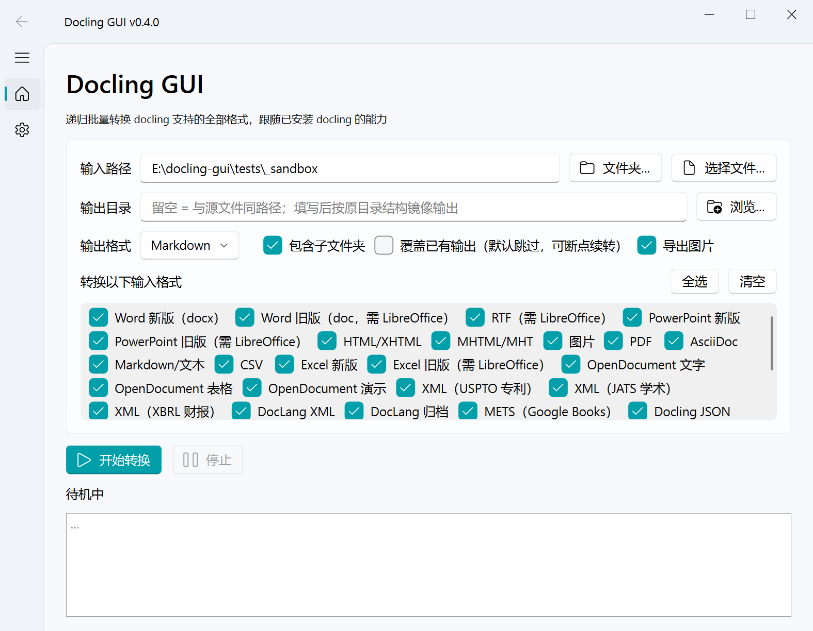
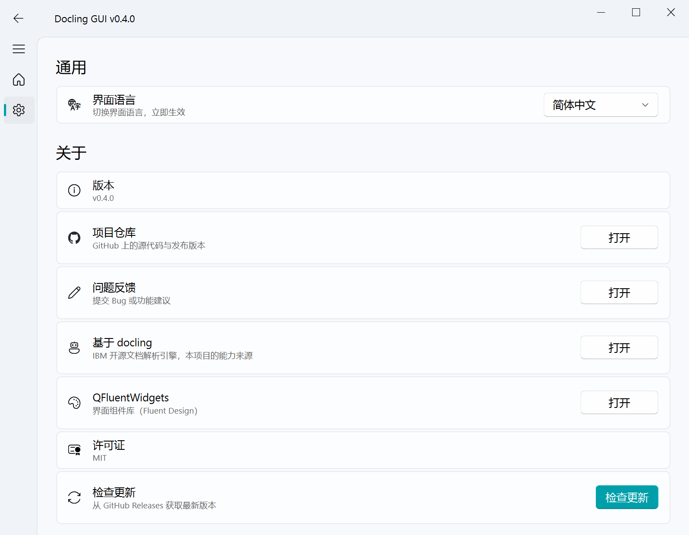

# Docling GUI

[](https://github.com/Ikaros-521/docling-gui/actions/workflows/build.yml)
[](https://github.com/Ikaros-521/docling-gui/releases)
[](LICENSE)
[](pyproject.toml)

[English](README.en.md) | 简体中文

**Docling GUI 是一款免费开源（MIT）的批量文档转换桌面应用**，为 IBM 开源文档解析引擎
[docling](https://github.com/docling-project/docling) 提供开箱即用的图形界面：
递归地把 **PDF、Word、Excel、PPT、图片、音频等 37 类格式 / 88 种扩展名**（docling 支持的全部格式）
批量转换为 **Markdown / HTML / JSON / DocTags / 纯文本**。
支持 Windows / macOS / Linux，**完全本地离线转换、无需编写代码，文档不出本机**。

> 一句话：想用 docling 做 PDF 转 Markdown / 批量文档转换，又不想写 Python——这就是现成的 GUI。



## 🎯 适用场景

- **知识库 / 笔记迁移**：批量把 PDF、Word、网页转成 Markdown，导入 Obsidian、Logseq、Notion 等
- **RAG / 大模型数据预处理**：输出 Markdown、无损 JSON（DoclingDocument）或 DocTags，供切块与检索
- **Office 文档归档**：递归处理多年积累的 .doc / .xls / .ppt（需 LibreOffice），统一输出
- **扫描件 OCR**：图片、扫描版 PDF 转可检索文本（docling 内置 OCR）
- **音视频转写**：音频与视频音轨转文字（ASR）

## ✨ 特性

- 📂 **递归批量 / 单文件**：输入可以是文件夹（递归处理所有子文件夹）或单个文件
- 🎯 **输出目录可选**：留空 = 与源文件同路径；填写 = 按原目录结构镜像输出（图片随输出文件存放）
- ✅ **输入格式勾选**：37 种输入格式逐项勾选（含旧版 Office、音频、Email 等全能力），动态跟随已安装 docling
- 🌐 **中英文界面**：设置页一键切换，即时生效；首次启动跟随系统语言
- 🔄 **检查更新**：设置页一键查询 GitHub Releases 最新版本
- 📦 **模型内置、完全离线**：v0.5.0 起安装包内置 PDF/图片管线模型（布局 + 表格），开箱即用无需联网；其他管线按需下载且 HF 不可达时自动切换镜像源
- 📤 **五种输出**：Markdown / HTML / JSON（DoclingDocument 无损）/ DocTags XML / 纯文本
- 🖼️ **图片导出**：md/html/json 输出时内嵌图片自动导出到 `<名称>_images/`，相对链接引用
- ⏸️ **可中断**：后台线程运行，随时停止；默认跳过已存在的输出，可断点续转
- 💻 **双模式**：GUI + 命令行；**测试覆盖**：核心逻辑单元测试（`pytest tests/`）



## 📥 支持的输入格式（docling 官方清单）

| 格式 | 备注/依赖 |
|---|---|
| PDF | 首次转换自动下载模型（布局/表格/OCR） |
| DOCX / XLSX / PPTX（Office 2007+） | 无需模型，纯解析 |
| DOC / XLS / PPT、RTF（旧版二进制） | 需系统安装 [LibreOffice](https://www.libreoffice.org/) |
| ODT / ODS / ODP（OpenDocument） | 无 |
| EPUB | 无 |
| HTML / XHTML / MHTML | 无 |
| Markdown / AsciiDoc / LaTeX / CSV / 纯文本 | 无 |
| PNG / JPEG / TIFF / BMP / WEBP / GIF | 首次转换自动下载模型（OCR） |
| WAV / MP3 / M4A / AAC / OGG / FLAC（音频） | 首次下载 ASR 模型 |
| MP4 / AVI / MOV / MKV / WEBM（视频，仅取音轨转写） | 同上，另需系统 ffmpeg |
| Email（.eml / .msg）、iCalendar、WebVTT、BoxNote、USPTO/JATS/XBRL XML、DocLang XML/archive 等 | 无 |
| Pages / Numbers / Keynote | 需 iWork 扩展（默认未启用） |

精确清单以本机为准：`docling-gui --list-formats`（GUI 的格式勾选面板亦动态生成）。

## 📤 输出格式

| 格式 | 后缀 | 说明 |
|---|---|---|
| Markdown | `.md` | 图片导出为相对链接 |
| HTML | `.html` | 图片导出为相对链接 |
| JSON | `.json` | DoclingDocument 无损结构（图片按引用保存） |
| DocTags | `.doctags` | XML 文档标记（面向训练/RAG 切块场景） |
| 纯文本 | `.txt` | 纯文本导出 |

## 📥 下载

到 [Releases](../../releases) 页面下载对应平台压缩包：

| 文件 | 平台 |
|---|---|
| `docling-gui-windows-x64.zip` | Windows 10+ x64 |
| `docling-gui-macos-arm64.zip` | macOS 12+ Apple Silicon（M1/M2/M3/M4） |
| `docling-gui-linux-x64.zip` | Linux x64 |

解压后运行 `docling-gui`（macOS 为 `docling-gui.app`）。

> **体积说明**：全格式版随包携带 torch/transformers/OCR 栈，压缩包为数 GB 级。
> **macOS 首次打开提示"已损坏"**：右键 → 打开，或 `xattr -cr /path/to/docling-gui.app`。
> **Linux**：图形界面依赖 xcb/xkbcommon 运行库（桌面发行版一般自带），
> 缺失时 `sudo apt install libxcb-cursor0 libxkbcommon0 libegl1`；
> 打包版无控制台，`--cli` 看不到输出，重度命令行用户建议源码运行。

## 🖱️ 使用

### GUI

1. 输入路径：选择文件夹（递归）或单个文件，也可直接拖入窗口
2. 输出目录：留空 = 与源文件同路径；填写后按原目录结构镜像输出
3. 输出格式 + 勾选要转换的输入格式、子文件夹 / 覆盖 / 图片选项
4. 点「开始转换」，日志实时显示每个文件的结果

技巧：把文件或文件夹拖到程序图标上启动会自动填入路径。

### 命令行

```bash
# 递归转换整个文件夹（默认输出 Markdown，与源文件同路径）
docling-gui D:\docs

# 转换单个文件 / 输出到指定目录（按原目录结构镜像）
docling-gui D:\docs\report.docx
docling-gui D:\docs --out E:\md_out

# 只转换指定格式（InputFormat 名，--list-formats 可查）
docling-gui D:\docs --formats pdf,docx,image

# 常用参数
--to md|html|json|doctags|txt   输出格式（默认 md）
--out DIR                       输出目录（留空 = 与源文件同路径）
--formats NAME[,NAME...]        只转换指定输入格式
--overwrite                     覆盖已存在的输出（默认跳过）
--no-images                     不导出内嵌图片
--flat                          不递归子文件夹
--list-formats                  列出当前支持的输入格式（含扩展名）
--version                       显示版本
```

## ❓ 常见问题（FAQ）

**Q：Docling GUI 是什么？和 docling 什么关系？**
A：docling 是 IBM 开源的文档解析引擎（Python 库 / CLI）；Docling GUI 是它的桌面图形界面 +
批量转换封装——解析质量与 docling 完全一致，本项目额外提供递归批量、格式勾选、图片导出、
断点续转、中英文界面和三平台免安装包。

**Q：需要安装 Python 或写代码吗？**
A：不需要。从 Releases 下载压缩包，解压即用。源码运行才需要 Python 3.10+。

**Q：文档会被上传到云端吗？**
A：不会。所有解析都在本地完成。v0.5.0 起安装包内置 PDF/图片管线模型，这类转换开箱即用、
完全离线；其余格式（如音频）首次使用时联网下载模型（缓存于 `~/.cache/huggingface`），
且 huggingface.co 不可达时自动切换 hf-mirror.com 镜像，之后可完全离线使用。

**Q：模型可以单独下载吗？**
A：可以。从 Release 下载 `docling-models.zip`（或自用 `huggingface_hub` 下载
`docling-project/docling-layout-heron` 与 `docling-project/docling-models` 的
tableformer 部分），解压后设置环境变量 `DOCLING_ARTIFACTS_PATH` 指向该目录即可；
不设置则使用安装包内置模型。

**Q：如何批量把 PDF 转成 Markdown 导入 Obsidian？**
A：选择 PDF 所在文件夹 → 输出格式选 Markdown → 可指定输出目录（按原目录结构镜像）→
开始转换。图片导出到 `<名称>_images/` 并以相对链接引用，连同 md 文件一起移入笔记库即可。

**Q：为什么第一次转换 PDF / 图片特别慢？**
A：首次会下载布局 / 表格 / OCR 模型（数百 MB），仅一次；之后转换走本地缓存。

**Q：可以商用吗？**
A：可以。MIT 许可证，个人与商业使用均免费。

## 🆚 与同类工具的关系

| 方案 | 解析引擎 | 使用方式 | 递归批量 |
|---|---|---|---|
| **Docling GUI** | docling | 桌面 GUI / 一行命令 | 内置，可断点续转 |
| docling 官方 | docling | Python API / CLI | 需自行写循环 |
| Marker | marker | CLI / 在线服务 | 需自行脚本 |
| MinerU | MinerU | CLI / 在线演示 | 需自行脚本 |
| Pandoc | 规则转换 | CLI | 无 OCR / 布局识别 |

认可 docling 引擎的解析质量（布局、表格、OCR、多语言）又不想写代码，Docling GUI 是最短路径。

## ⚠️ 已知限制

- **首次转换 PDF / 图片 / 音频会自动下载模型**到 `~/.cache/docling`（数百 MB，仅一次）
- 旧版 .doc/.xls/.ppt/.rtf 需要系统安装 LibreOffice（`soffice` 在 PATH 或默认安装路径）
- 视频（音轨转写）另需系统 ffmpeg；Pages/Numbers/Keynote 需 iWork 扩展
- 受密码保护/损坏的文件会失败并在日志标出，不影响其他文件
- 图片链接为相对路径，移动输出文件时请连同 `<名称>_images/` 一起移动
- 上一轮生成的输出（如 .md）和 `<名称>_images/` 目录会被扫描器自动跳过，不会循环转换

## 🛠️ 源码运行 / 开发

依赖 Python ≥ 3.10。

```bash
python -m venv .venv
.venv/Scripts/pip install -r requirements.txt -e .        # Windows
# .venv/bin/pip install -r requirements.txt -e .          # macOS / Linux

python -m docling_gui                 # 启动 GUI
python -m docling_gui D:\docs --cli   # 命令行模式

# 单元测试（不依赖 docling 模型，秒级）
pip install pytest
pytest tests/ -v
```

生成多格式测试样例并自测：

```bash
pip install python-docx python-pptx openpyxl pillow   # fixture 生成依赖
python tests/make_fixtures.py tests/_sandbox
python -m docling_gui tests/_sandbox --cli
```

## 🔨 自行打包 / CI 打包

本仓库带 [GitHub Actions 工作流](.github/workflows/build.yml)（`docling-gui.spec` 为
PyInstaller 配置）。两种触发方式：

- **推送版本标签**：`git tag v0.4.0 && git push origin v0.4.0`，构建完成后自动发布 Release
- **手动**：Actions 页面 → Build & Release → Run workflow（产物在 Actions Artifacts）

本地打包：

```bash
pip install pyinstaller
pyinstaller docling-gui.spec --noconfirm
# 产物在 dist/docling-gui/
```

打包要点（踩坑记录，详见 spec 注释）：docling 的插件注册依赖 dist-info 元数据
（`copy_metadata("docling_slim")`）与 entry_points 动态导入的插件模块
（`docling.models.plugins.defaults` 需显式 hiddenimports）；qfluentwidgets 资源需
`collect_all`；easyocr/docling_ibm_models 自带数据文件需收集。

## 🧱 项目结构

```
├── src/docling_gui/
│   ├── core/               # 域逻辑（无 GUI 依赖，GUI/CLI 共用）
│   │   ├── formats.py      #   输出格式清单 + 输入格式动态发现
│   │   ├── scanner.py      #   文件扫描与过滤（递归/格式勾选/跳过规则）
│   │   └── converter.py    #   BatchConverter（同路径/镜像输出、图片导出）
│   ├── gui/                # 界面层（PySide6 + QFluentWidgets）
│   │   ├── main_window.py  #   主窗口（转换页，中英文热切换）
│   │   ├── settings_page.py#   设置页（语言 / 关于 / 检查更新）
│   │   ├── workers.py      #   后台线程（转换 / 格式加载 / 更新检查）
│   │   └── bootstrap.py    #   run_gui()
│   ├── cli.py              # 命令行入口（argparse）
│   ├── i18n.py             # 中英文词表与取词（纯 Python）
│   └── __main__.py         # python -m 入口
├── tests/                  # 单元测试 + 测试样例生成器
├── docs/                   # 截图等文档资源
├── docling-gui.spec        # PyInstaller 打包配置（三平台共用）
└── .github/workflows/build.yml  # 三平台 CI 打包 + Release
```

## 🙏 致谢

- [docling](https://github.com/docling-project/docling) — IBM 开源文档解析引擎，本项目的全部解析能力来自它
- [QFluentWidgets](https://qfluentwidgets.com/) — Fluent Design 风格的 PySide6 组件库

## 📄 许可证

[MIT](LICENSE)